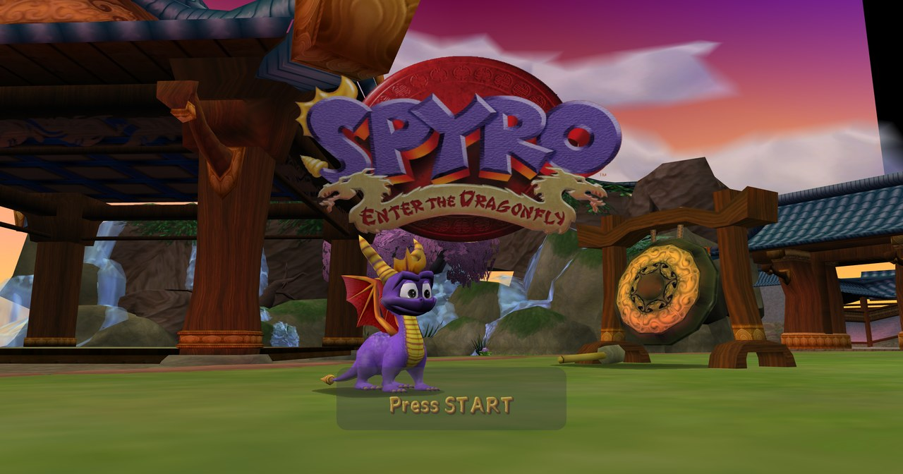
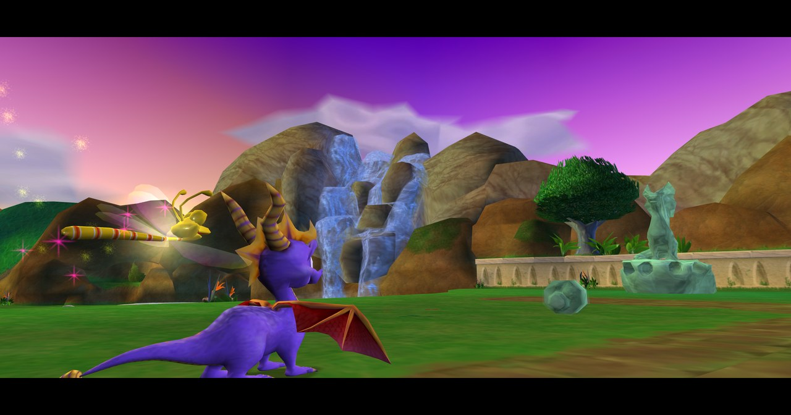
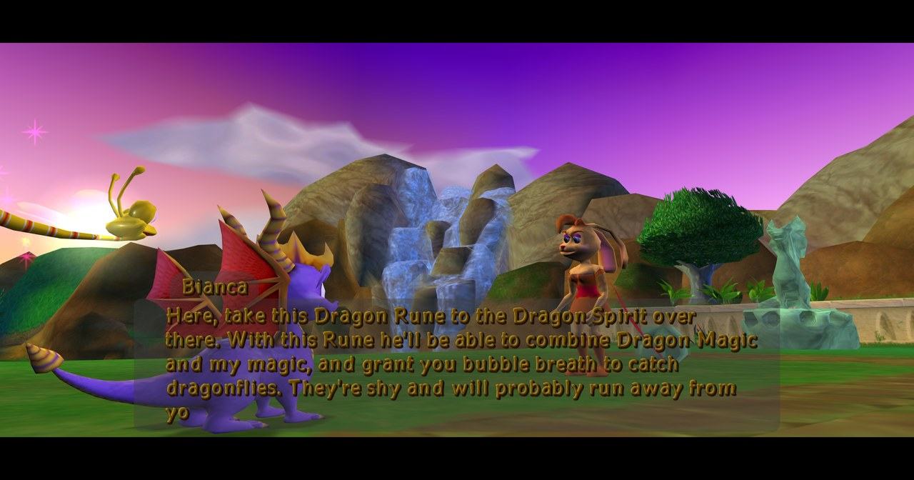
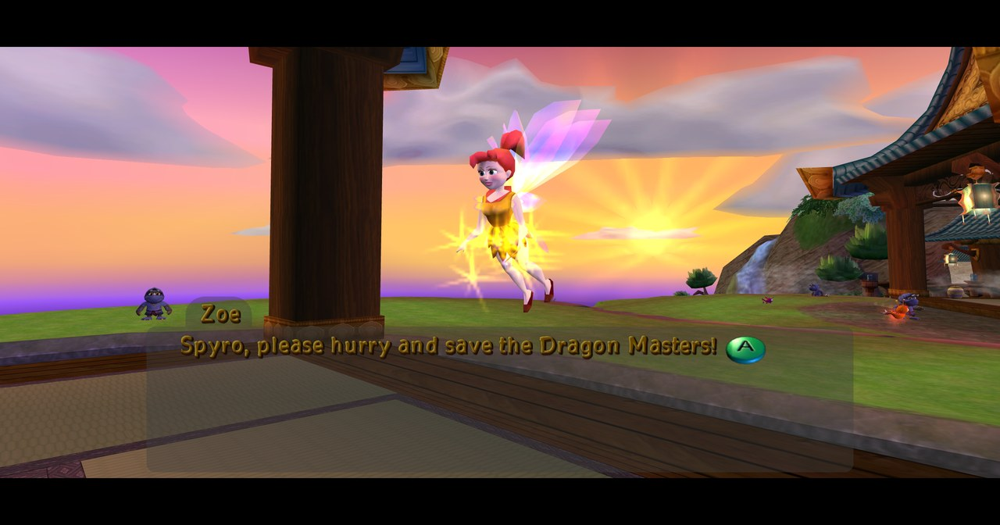
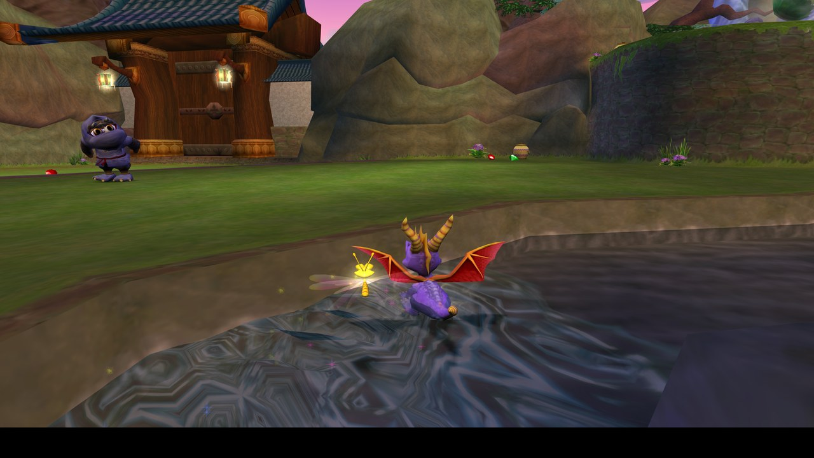
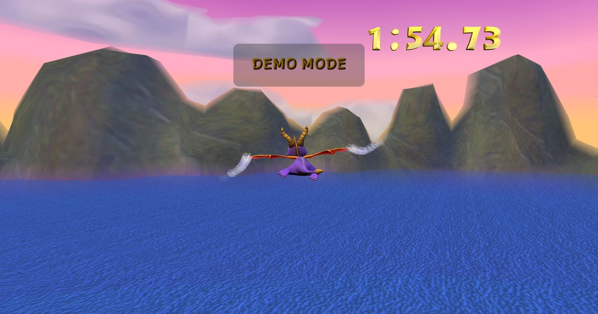
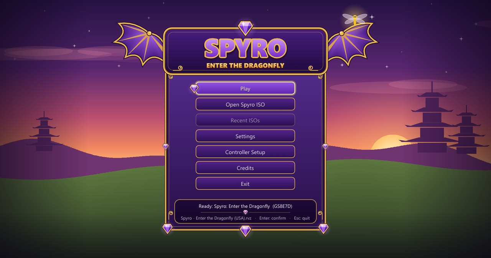
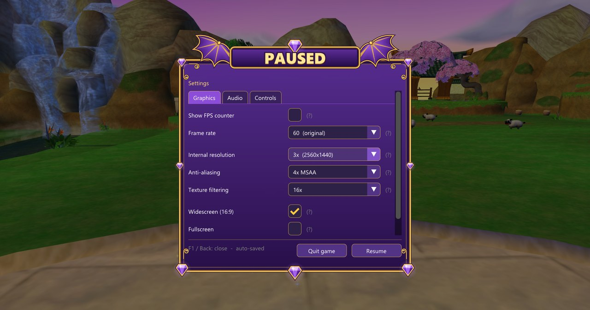
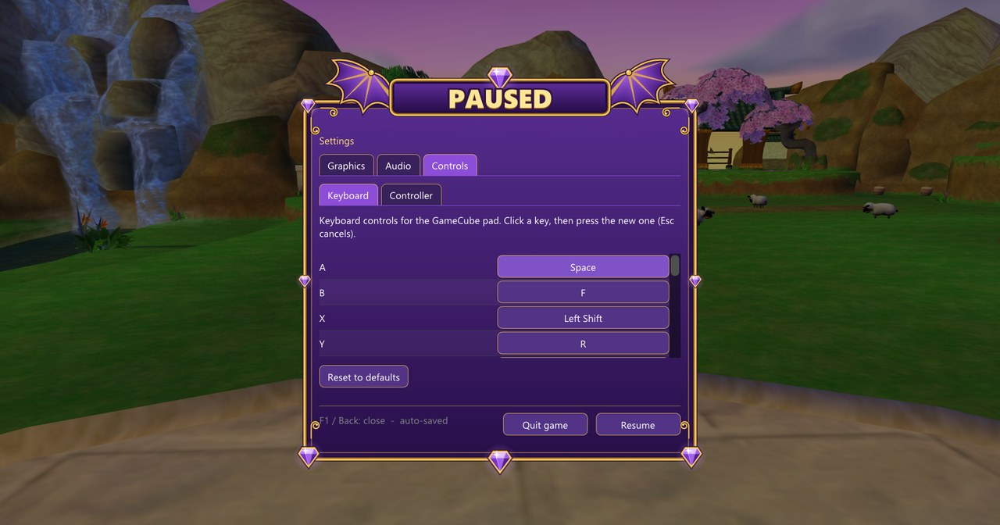
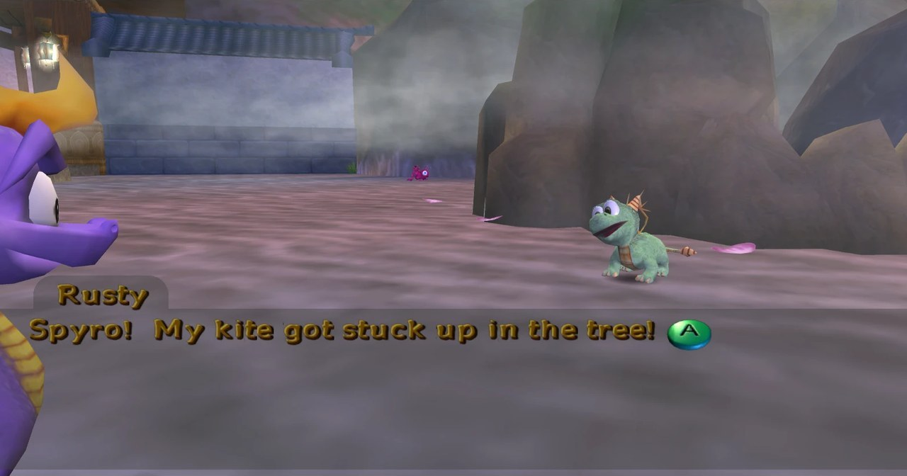

# Spyro: Re-Enter the Dragonfly (GameCube → PC)



A native Windows port of **Spyro: Enter the Dragonfly** (GameCube, USA,
`GS8E7D`), made by statically recompiling the game's PowerPC code into C++
with [NWiiRecomp](https://github.com/BlackLineInteractive/NWiiRecomp). No
emulator runs the game: its code is translated ahead of time and runs
natively, with the console's hardware replaced by a high-level runtime
(graphics on OpenGL, audio, controllers, memory card).

**No game data is included.** You need your own copy of the game disc. The
build reads it to produce the executable on your machine.

## Features

- Boots straight from your disc: `.rvz`, `.iso` / `.gcm` or an extracted folder.
- Title menu before the game (Play, Open Spyro ISO, Recent ISOs, Memory Card
  & BIOS, Settings, Controller Setup) and a themed pause/settings menu (F1 or the controller's
  Back/View button).
- Internal resolution up to 8×, MSAA, anisotropic filtering, aspect ratios up to 32:9
  (wider field of view, HUD kept 4:3), fullscreen, VSync, FPS counter.
- Steady 60 fps; 90 and 120 fps modes (experimental, heavy scenes can dip).
- Keyboard and controller (XInput/SDL), both rebindable in the menu.
- Saves to a memory card file next to the game (`memcard_A.raw`), or one you
  pick in the title menu. A GameCube BIOS can be picked there too; only its
  fonts are used.

## Screenshots

All taken at 3× internal resolution, 4× MSAA, 16:9 widescreen.

| | |
| --- | --- |
|  |  |
| The hub at sunset | Talking to Bianca |
|  |  |
| Zoe in Dragonfly Dojo | Dragonfly Dojo's town |
|  |  |
| The attract-mode demo | Title menu: pick your disc, settings, controller setup |
|  |  |
| Graphics settings (F1) | Keyboard and controller rebinding |

## Building

Requirements: Windows 10/11, [Visual Studio 2022](https://visualstudio.microsoft.com/)
with *Desktop development with C++*, CMake 3.20+ (bundled with Visual Studio
works), Git, and [Python 3](https://www.python.org/) (optional: without it a
few hot math functions stay unoptimised). The first build downloads its
libraries (SDL2, Dear ImGui, toml++, zstd) and takes a while.

```powershell
git clone --recursive https://github.com/sysoutch/spyro-reenter-the-dragonfly-gcn.git
cd spyro-reenter-the-dragonfly-gcn
.\build.ps1 -Disc "D:\Games\Spyro - Enter the Dragonfly (USA).rvz"
.\run-spyro.ps1
```

`build.ps1` builds the recompiler, translates the game's code into `export\`
and builds `export\build\Release\SpyroEnterTheDragonfly.exe`. Put the disc
next to `build.ps1` and you can leave out `-Disc`. Run it again after
updating; it only rebuilds what changed.

`.wia`, `.gcz`, `.ciso` and `.wbfs` images have to be converted first, e.g. in
Dolphin: right-click the game → *Convert File...* → ISO or RVZ.

## Playing

Double-click `Play Spyro.bat` (or run `run-spyro.ps1`): it starts the game
with the disc next to it, or lets you pick one in the title menu. Starting
`SpyroEnterTheDragonfly.exe` directly works too. Settings are saved to
`spyro.toml`, created from `spyro.default.toml` the first time.

| GameCube | Keyboard | Controller |
| --- | --- | --- |
| Stick | W A S D | Left stick |
| C-stick (camera) | Arrow keys | Right stick |
| A / B / X / Y | Space / F / Left Shift / R | A / B / X / Y |
| L / R / Z | Q / E / Tab | LB / RB / RT |
| Start | Enter | Start |
| D-pad | Numpad 8 2 4 6 | D-pad |

F1 opens the settings, F2 toggles the FPS counter, F11 or Alt+Enter toggles
fullscreen. On a fresh memory card the game reports it as corrupted: choose
*Format*, then *Create new save data*.

## Known issues

- No reverb on game audio (aux effects are not emulated).
- An NPC in Dragonfly Dojo, Rusty the baby dragon, once stopped
  responding; it could not be reproduced since. Getting stuck at an NPC
  is a known bug of the original release
  ([video](https://youtu.be/fCXtjr0SrX0?t=305)).

  
- At 120 fps the busiest scenes are limited by rendering.

## Layout

```
Play Spyro.bat       start the game (double-click; runs run-spyro.ps1)
build.ps1            disc -> executable
spyro.default.toml   recompiler settings (function hooks) + default game settings
NWiiRecomp/          the recompiler and runtime (submodule, fork with this port's changes)
docs/NOTES.md        what was fixed and how, every debug switch
tools/               profiling, screenshot, disc and code-generation tools
difftest/            recompiler vs. interpreter instruction tests
```

## Credits

- [NWiiRecomp](https://github.com/BlackLineInteractive/NWiiRecomp) by
  Volodymyr Vovchok / BlackLine Interactive: the recompiler and runtime this
  port is built on.
- [Dolphin](https://dolphin-emu.org/): SDK signature database, the free IPL
  replacement fonts, and documentation of the hardware and the RVZ format.
- SDL2, Dear ImGui, toml++, glad, zstd.

## License

Non-commercial use only: this project is a derivative of NWiiRecomp and uses
its license. See [LICENSE](LICENSE). Spyro: Enter the Dragonfly and Spyro are
trademarks of their respective owners; this project is not affiliated with or
endorsed by them.
